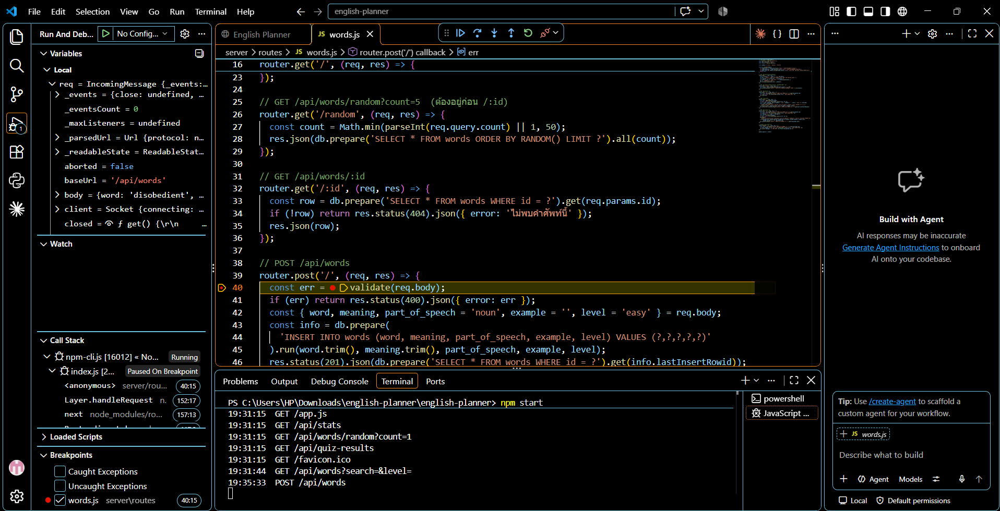
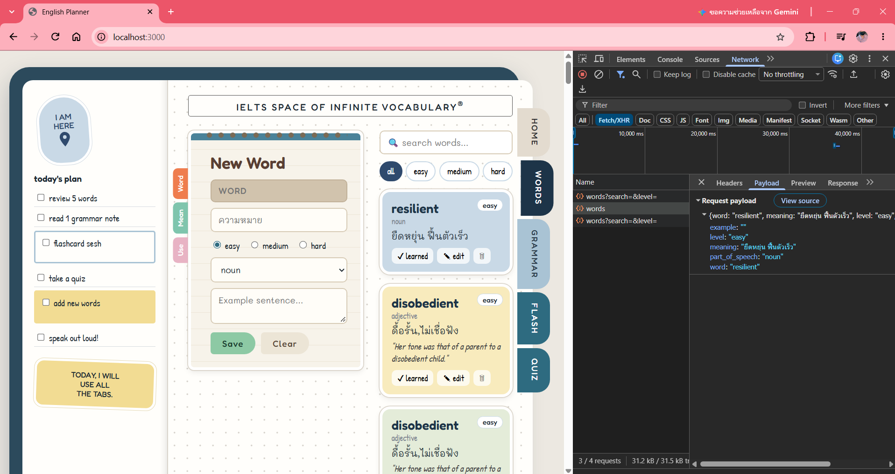
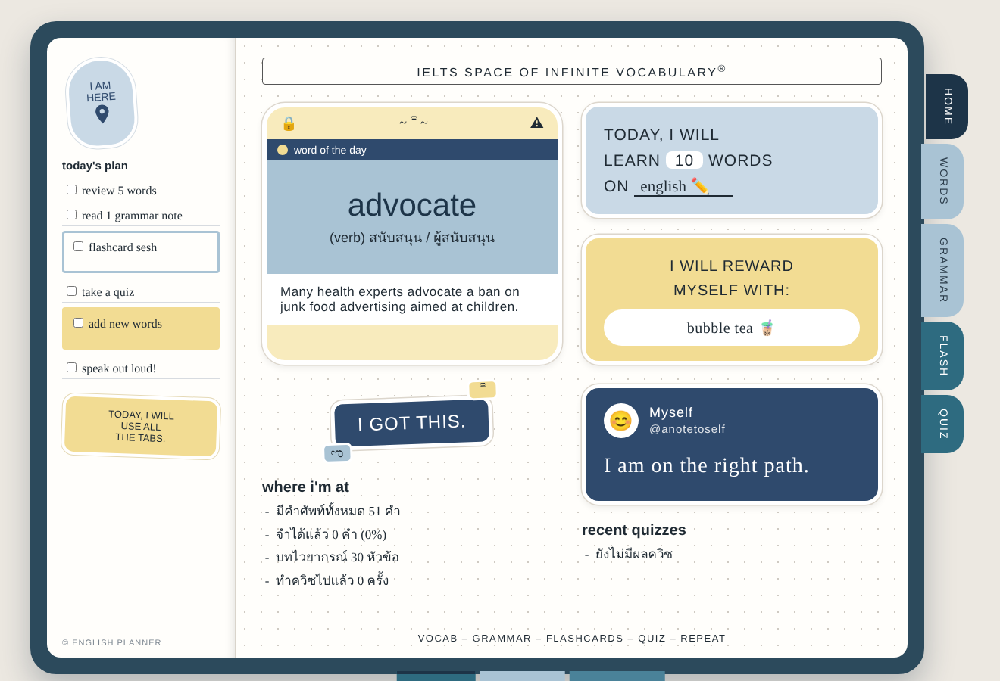
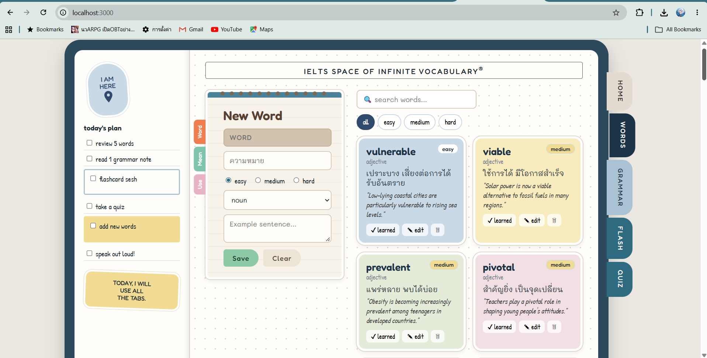

# English Planner

เว็บแอปพลิเคชันสำหรับฝึกภาษาอังกฤษ ออกแบบหน้าตาเป็น **สมุดแพลนเนอร์** 
ผู้ใช้สามารถจัดการ **คำศัพท์ (vocabulary)** และ **บทเรียนไวยากรณ์ (grammar)** ได้ครบทั้ง เพิ่ม ดู แก้ไข ลบ
แล้วนำคำศัพท์ไปทบทวนผ่าน **แฟลชการ์ด** และ **ควิซ** ซึ่งบันทึกคะแนนลงฐานข้อมูล

## ฟีเจอร์

| แท็บ | ทำอะไรได้ |
|---|---|
| **HOME** | คำศัพท์ประจำวัน (สุ่มจากฐานข้อมูล), สถิติการเรียน, ผลควิซล่าสุด |
| **WORDS** | เพิ่ม / แก้ไข / ลบคำศัพท์, ค้นหา, กรองตามระดับ, ติ๊กว่าจำได้แล้ว |
| **GRAMMAR** | เพิ่ม / แก้ไข / ลบหัวข้อไวยากรณ์ พร้อมโครงสร้างประโยค คำอธิบาย และตัวอย่าง |
| **FLASH** | แฟลชการ์ดพลิกดูความหมาย และกด "learned" เพื่อบันทึกลงฐานข้อมูล |
| **QUIZ** | ควิซ 4 ตัวเลือก 5 ข้อ สุ่มจากคำศัพท์ในฐานข้อมูล แล้วบันทึกคะแนน |

แท็บด้านล่าง (DOT / GRID / BLANK) ใช้เปลี่ยนลายกระดาษของหน้าเว็บ

## เทคโนโลยีที่ใช้

- **Backend:** Node.js + Express
- **Database:** SQLite (โมดูล `node:sqlite` ที่มีมากับ Node.js ไม่ต้องติดตั้งเพิ่ม) — ไฟล์ `server/english.db` ถูกสร้างอัตโนมัติพร้อมข้อมูลตัวอย่างเมื่อรันครั้งแรก
- **Frontend:** HTML, CSS, JavaScript (Fetch API)

## โครงสร้างโปรเจกต์

```
english-planner/
├── server/                 # ฝั่งเซิร์ฟเวอร์ (backend)
│   ├── index.js            # จุดเริ่มต้น Express, เสิร์ฟ /public, รวม routes
│   ├── db.js               # เชื่อมต่อ SQLite, สร้างตาราง, ใส่ข้อมูลตัวอย่าง
│   └── routes/
│       ├── words.js        # /api/words
│       └── grammar.js      # /api/grammar
├── public/                 # ฝั่งไคลเอนต์ (frontend)
│   ├── index.html
│   ├── style.css
│   └── app.js
├── images/                 # ภาพหลักฐานการดีบัก
├── package.json
└── README.md
```

## วิธีติดตั้ง

ต้องมี [Node.js](https://nodejs.org/) เวอร์ชัน 22.13 ขึ้นไป (แนะนำ 22 LTS หรือ 24)

```bash
git clone https://github.com/nopparat-ploy/english-planner.git
cd english-planner
npm install
```

## วิธีรัน

```bash
npm run dev
```

แล้วเปิด **http://localhost:3000** ในเบราว์เซอร์
(`npm run dev` ใช้ `node --watch` จึงรีสตาร์ทเซิร์ฟเวอร์ให้เองเมื่อแก้ไขไฟล์ ส่วน `npm start` ใช้รันแบบปกติ)

## ฐานข้อมูล

| ตาราง | คอลัมน์ |
|---|---|
| `words` | id, word, meaning, part_of_speech, example, level (easy/medium/hard), learned (0/1), created_at |
| `grammar` | id, title, structure, explanation, example, level, created_at |
| `quiz_results` | id, score, total, created_at |

## รายการ Endpoint ทั้งหมด

### คำศัพท์ — `/api/words`

| Method | Endpoint | คำอธิบาย |
|---|---|---|
| GET | `/api/words` | ดูคำศัพท์ทั้งหมด รองรับ query `?search=` และ `?level=easy\|medium\|hard` |
| GET | `/api/words/random?count=5` | สุ่มคำศัพท์ตามจำนวน (สูงสุด 50) ใช้กับแฟลชการ์ด/ควิซ |
| GET | `/api/words/:id` | ดูคำศัพท์ 1 คำ |
| POST | `/api/words` | เพิ่มคำศัพท์ (ต้องมี `word`, `meaning`) |
| PUT | `/api/words/:id` | แก้ไขคำศัพท์ (ส่งเฉพาะฟิลด์ที่ต้องการแก้ได้ เช่น `{ "learned": 1 }`) |
| DELETE | `/api/words/:id` | ลบคำศัพท์ |

ตัวอย่าง body ของ POST:
```json
{ "word": "brave", "meaning": "กล้าหาญ", "part_of_speech": "adjective", "example": "Be brave!", "level": "easy" }
```

### ไวยากรณ์ — `/api/grammar`

| Method | Endpoint | คำอธิบาย |
|---|---|---|
| GET | `/api/grammar` | ดูหัวข้อไวยากรณ์ทั้งหมด รองรับ `?search=` |
| GET | `/api/grammar/:id` | ดูหัวข้อเดียว |
| POST | `/api/grammar` | เพิ่มหัวข้อ (ต้องมี `title`, `structure`, `explanation`) |
| PUT | `/api/grammar/:id` | แก้ไขหัวข้อ |
| DELETE | `/api/grammar/:id` | ลบหัวข้อ |

### อื่น ๆ

| Method | Endpoint | คำอธิบาย |
|---|---|---|
| GET | `/api/quiz-results` | ดูผลควิซ 10 ครั้งล่าสุด |
| POST | `/api/quiz-results` | บันทึกคะแนนควิซ `{ "score": 4, "total": 5 }` |
| GET | `/api/stats` | สถิติรวม: จำนวนคำ, คำที่จำได้, หัวข้อไวยากรณ์, จำนวนครั้งที่ทำควิซ |

ทุก endpoint ส่งข้อมูลเป็น JSON และเมื่อเกิดข้อผิดพลาดจะส่ง `{ "error": "..." }` พร้อม status code ที่เหมาะสม (400 ข้อมูลไม่ครบ, 404 ไม่พบข้อมูล, 500 เซิร์ฟเวอร์ผิดพลาด)

## ภาพหลักฐานการดีบัก

### 1. ฝั่งเซิร์ฟเวอร์ (Backend)



### 2. ฝั่งไคลเอนต์ (Frontend)



## หน้าตาเว็บ


